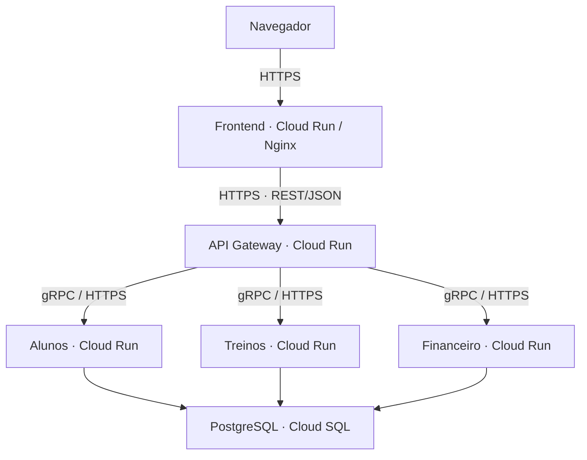

# GymFlow — Sistema Distribuído de Gestão de Academia

Projeto da disciplina de **Sistemas Distribuídos** para cadastrar alunos, organizar fichas de treino e acompanhar mensalidades.

A versão final utiliza **cinco serviços no Google Cloud Run** e **PostgreSQL no Cloud SQL**. As imagens ficam no Artifact Registry e a publicação utiliza Cloud Build. Nenhum componente da aplicação depende de execução direta em uma VM do Compute Engine.

**Branch da entrega final:** [`develop`](https://github.com/igordantas-dev/Trabalho-de-SD/tree/develop).

## Acessar o sistema

Não é necessário instalar programas nem manter um computador ou Cloud Shell aberto para usar a versão publicada.

| Acesso | Endereço |
|---|---|
| Painel de gestão | [Abrir o painel](https://gymflow-frontend-qywzrohxza-uc.a.run.app/) |
| Portal do Aluno | [Abrir o portal](https://gymflow-frontend-qywzrohxza-uc.a.run.app/aluno.html) |
| Documentação da API | [Swagger UI](https://gymflow-gateway-qywzrohxza-uc.a.run.app/swagger-ui.html) |

Clique em **Entrar na demonstração**. No portal, selecione o aluno cujos dados deseja consultar. Os dados cadastrados são compartilhados entre os usuários da versão em nuvem e persistidos no Cloud SQL.

> **Acesso didático:** a demonstração não utiliza contas individuais nem verifica a identidade do aluno. Use dados fictícios. O Gateway valida assinatura e validade de tokens JWT, mas a emissão pública desses tokens não representa um sistema de autenticação para produção.

## O que a aplicação faz

| Área | Funcionalidades |
|---|---|
| Alunos | Cadastro, listagem, consulta e alteração do status da matrícula: `ATIVO`, `INADIMPLENTE` ou `INATIVO`. |
| Treinos | Criação de várias fichas por aluno, consulta de exercícios e registro das cargas usadas e dos exercícios feitos. |
| Gerador de treinos | Geração automática por regras e gravação da ficha no serviço de treinos. |
| Mensalidades | Criação de mensalidades, consulta por aluno e registro manual de pagamentos recebidos. |
| Portal do Aluno | Consulta de cadastro, fichas e mensalidades; registro de execução de treinos quando a matrícula permite. |

Os painéis de cadastro começam recolhidos, enquanto as listas começam abertas. Recolher um painel preserva o preenchimento. Ao mudar de aba, o contexto é limpo; havendo alterações não salvas, a interface pede confirmação.

### Regras e limites da demonstração

- **Execução do treino:** sem exercícios feitos, a ficha aparece como Pendente; com parte feita, Em andamento; com todos feitos, Concluído. Desmarcar um exercício e salvar remove a conclusão. O registro atual é atualizado na própria ficha; não existe histórico separado de sessões por dia.
- **Matrícula inativa:** o histórico continua consultável, mas o registro de execução é bloqueado no portal e na API REST do Gateway. O Gateway consulta a matrícula do aluno vinculado à ficha antes de encaminhar a gravação.
- **Pagamento:** “Registrar pagamento recebido” faz uma baixa manual no banco. Não existe cobrança, emissão real de boleto ou transação PIX/cartão. O portal permite somente consultar as mensalidades.
- **Gerador de treinos:** a aba ainda se chama “Treino IA”, mas o resultado atual é produzido por regras locais de peso, nível e foco muscular. O código possui uma consulta opcional ao Gemini, porém não aproveita os exercícios retornados pelo modelo. Objetivo e observações não modificam a prescrição do gerador local.
- **Cadastro e financeiro:** edição dos dados pessoais, exclusão definitiva de alunos e filtros gerais de mensalidades ainda não estão implementados. A consulta financeira atual é por aluno.

## Arquitetura

O navegador envia requisições **REST/JSON** ao frontend. O Nginx encaminha `/api/` ao Gateway, que chama os microsserviços usando **gRPC/Protocol Buffers**. Cada microsserviço acessa os dados de seu domínio no PostgreSQL; o Gateway não acessa o banco diretamente.



Os domínios compartilham a instância e o banco `academia`. `aluno_id` em fichas e mensalidades é uma referência lógica, sem chave estrangeira entre esses domínios. Os itens de treino possuem chave estrangeira para sua ficha.

| Componente | Tecnologia / responsabilidade |
|---|---|
| `frontend/` | HTML, CSS e JavaScript servidos por Nginx em contêiner próprio. |
| `api-gateway/` | Java 21, Spring Boot, Spring Security, validação de requisições, JWT e tradução REST/gRPC. |
| `aluno-service/` | Java 21, gRPC e JPA/Hibernate para cadastro e matrícula. |
| `treino-service/` | Java 21, gRPC e JPA/Hibernate para fichas, exercícios e execução. |
| `financeiro-service/` | Java 21, gRPC e JPA/Hibernate para mensalidades e pagamentos registrados. |
| `contratos-grpc/` | Arquivos `.proto` e geração das mensagens e interfaces de comunicação. |

### Serviços gerenciados no GCP

Projeto: `sd2026`. Região dos serviços: `us-central1`.

| Recurso | Uso |
|---|---|
| Cloud Run | Execução dos cinco componentes, com endpoints HTTPS. |
| Cloud SQL | PostgreSQL 16, instância `gymflow-db`, banco `academia`. |
| Artifact Registry | Repositório Docker `us-central1-docker.pkg.dev/sd2026/gymflow`. |
| Cloud Build | Construção e publicação das imagens a partir do código-fonte. |
| Secret Manager | Segredos do banco e da assinatura JWT, referenciados pelos serviços. |
| Cloud Logging | Logs de execução e das tentativas de chamadas gRPC. |

| Serviço no Cloud Run | URL pública HTTPS |
|---|---|
| `gymflow-frontend` | https://gymflow-frontend-qywzrohxza-uc.a.run.app |
| `gymflow-gateway` | https://gymflow-gateway-qywzrohxza-uc.a.run.app |
| `gymflow-aluno` | https://gymflow-aluno-qywzrohxza-uc.a.run.app |
| `gymflow-treino` | https://gymflow-treino-qywzrohxza-uc.a.run.app |
| `gymflow-financeiro` | https://gymflow-financeiro-qywzrohxza-uc.a.run.app |

As URLs dos microsserviços recebem chamadas gRPC; não são páginas web. A comunicação usa TLS até o Cloud Run e HTTP/2 sem TLS dentro dos contêineres gRPC. Os endpoints da plataforma permitem invocação pública; não há autenticação IAM entre os serviços nesta demonstração.

## Executar localmente com Docker

### Pré-requisitos

- Git.
- Docker Desktop iniciado, com contêineres Linux e Docker Compose.
- PowerShell para os comandos e scripts abaixo.
- Internet para o primeiro download de imagens e dependências.

O build em Docker já fornece Java 21 e Maven. Não é necessário instalá-los no computador para executar esse fluxo. Prefira um caminho sem acentos, como `C:\workspace`, para evitar problemas com ferramentas de geração de código no Windows.

### Primeira instalação

```powershell
New-Item -ItemType Directory -Force C:\workspace | Out-Null
cd C:\workspace
git clone --branch develop https://github.com/igordantas-dev/Trabalho-de-SD.git
cd Trabalho-de-SD

docker volume create gymflow-postgres-data
docker compose --parallel 1 build
docker compose up -d
docker compose ps
```

O build é sequencial para reduzir o uso de memória. São iniciados seis contêineres: frontend, Gateway, três microsserviços e PostgreSQL. Aguarde a inicialização dos serviços antes de testar.

> Se já houver um PostgreSQL antigo usando `gymflow-postgres-data`, pare-o antes de iniciar o Compose. Não execute dois bancos sobre o mesmo volume. As credenciais do Compose são somente para desenvolvimento; em um volume existente, as variáveis de inicialização não substituem usuários ou senhas.

| Acesso local | Endereço |
|---|---|
| Painel | http://localhost:8081 |
| Portal do Aluno | http://localhost:8081/aluno.html |
| Swagger do Gateway | http://localhost:8080/swagger-ui.html |
| OpenAPI em JSON | http://localhost:8080/v3/api-docs |

O banco local usa o volume externo `gymflow-postgres-data`. Ele é separado do banco do GCP: cadastros locais não aparecem automaticamente no sistema público.

### Comandos do dia a dia

Execute na raiz do repositório:

```powershell
# Iniciar os contêineres existentes
docker compose up -d

# Acompanhar os logs; Ctrl+C encerra apenas o acompanhamento
docker compose logs -f

# Parar e remover os contêineres, preservando o volume externo
docker compose down
```

Após alterações no código, reconstrua os componentes modificados. Exemplo para frontend e Gateway:

```powershell
docker compose --parallel 1 build frontend api-gateway
docker compose up -d --no-deps api-gateway frontend
```

Atualize o navegador com **Ctrl+F5**. Detalhes adicionais da execução local: [DOCKER.md](DOCKER.md).

## Testar o sistema

### Fluxo completo — PowerShell local

```powershell
# Testar a instalação local
powershell -NoProfile -ExecutionPolicy Bypass -File .\scripts\Test-Gymflow.ps1

# Testar a versão publicada
powershell -NoProfile -ExecutionPolicy Bypass -File .\scripts\Test-Gymflow.ps1 -BaseUrl "https://gymflow-frontend-qywzrohxza-uc.a.run.app"
```

O teste cria um aluno fictício, cria e consulta uma ficha, gera uma mensalidade e registra/consulta o pagamento. Cada execução deixa novos registros no banco do ambiente escolhido. Nenhum dinheiro é transferido.

### Resiliência

O Gateway aplica **até três tentativas, incluindo a primeira**, às consultas gRPC configuradas, quando ocorre `UNAVAILABLE`. Usa espera inicial de 200 ms, multiplicador 2, teto de 1 s e variação aleatória. O prazo total da chamada inclui as tentativas e esperas: padrão local de 5 s e configuração de 20 s no Gateway do GCP.

Cadastros, pagamentos e atualizações não têm essa política de repetição, para evitar duplicar operações. Falhas são traduzidas para HTTP, incluindo `503` para indisponibilidade e `504` para prazo esgotado.

**Teste local, no PowerShell:**

```powershell
powershell -NoProfile -ExecutionPolicy Bypass -File .\scripts\Test-Resiliencia.ps1
```

Ele interrompe temporariamente o contêiner financeiro, verifica o tratamento da falha e a disponibilidade de alunos, e reinicia o financeiro.

**Teste no GCP, no Cloud Shell:**

```bash
cd ~/Trabalho-de-SD
python3 scripts/Test-Resiliencia-Gcp.py
```

Ele altera temporariamente o destino financeiro no Gateway para simular perda de comunicação, verifica HTTP 503, confirma que alunos continuam disponíveis e procura as tentativas 1, 2 e 3 da mesma chamada no Cloud Logging. Ao final, restaura o endereço e verifica HTTP 200. Não desliga o serviço financeiro no Cloud Run.

Se houver uma restauração pendente após interrupção do teste:

```bash
python3 scripts/Test-Resiliencia-Gcp.py --restore
```

## Banco de dados e migrações

A baseline SQL versionada fica em [`db/migrations/V001__schema_inicial.sql`](db/migrations/V001__schema_inicial.sql). O fluxo aplica o schema, valida sua estrutura e registra a versão em `schema_migrations`, sem inserir dados simulados no banco da aplicação.

| Arquivo | Finalidade |
|---|---|
| [`db/Apply.psql`](db/Apply.psql) | Aplicar e registrar a baseline em uma transação. |
| [`db/Validate.psql`](db/Validate.psql) | Conferir estrutura e contagens em uma transação de leitura. |
| [`scripts/Test-Schema.ps1`](scripts/Test-Schema.ps1) | Testar criação, reaplicação, preservação de dados e rejeição de divergências em banco descartável. |
| [`scripts/CloudSql-Schema.py`](scripts/CloudSql-Schema.py) | Executar validação ou aplicação no Cloud SQL usando Secret Manager e um proxy temporário. |

No Cloud Shell, para validar o banco existente:

```bash
python3 scripts/CloudSql-Schema.py validate
```

Os microsserviços publicados usam `DB_SCHEMA_MODE=validate`; no Compose local, o padrão é `update`. A criação inicial e a aplicação manual da baseline estão descritas em [db/README.md](db/README.md). Os arquivos de `db/tests/` pertencem somente aos testes isolados.

## Publicar atualizações no GCP

Este fluxo atualiza serviços **já criados e configurados**. Requer acesso ao projeto, às imagens e ao Cloud Build. Envie primeiro os commits da `develop` ao GitHub.

No **Cloud Shell**, atualize o código e publique as imagens de frontend e Gateway:

```bash
cd ~/Trabalho-de-SD
git switch develop
git pull --ff-only origin develop
TAG="$(git rev-parse --short HEAD)"

gcloud builds submit . \
  --project=sd2026 \
  --region=us-central1 \
  --config=cloudbuild/frontend-gateway.json \
  --ignore-file=.dockerignore \
  --substitutions="_TAG=$TAG"
```

Aguarde **STATUS: SUCCESS** antes de executar os comandos de atualização:

```bash
gcloud run services update gymflow-gateway \
  --project=sd2026 --region=us-central1 \
  --image="us-central1-docker.pkg.dev/sd2026/gymflow/api-gateway:$TAG"

gcloud run services update gymflow-frontend \
  --project=sd2026 --region=us-central1 \
  --image="us-central1-docker.pkg.dev/sd2026/gymflow/frontend:$TAG"
```

Esses comandos alteram as imagens, preservando variáveis, referências a secrets e identidades existentes. A configuração [`cloudbuild/frontend-gateway.json`](cloudbuild/frontend-gateway.json) constrói somente esses dois componentes; alterações em outros microsserviços exigem publicar e atualizar suas respectivas imagens.

A tag identifica o commit usado no build, não o estado atual de todas as revisões. O teste de resiliência também cria revisões ao alterar e restaurar o destino financeiro. Para verificar as revisões e imagens efetivas, consulte o Cloud Run. Informações complementares: [GCP.md](GCP.md).

## Integrantes

- Andressa Gonçalves Barros
- Igor Carvalho Dantas
- Wallace Elpidio Pereira Cardoso
